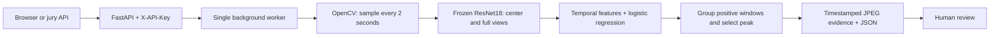

# Clearity

**Offline cashier-video review prototype for ForteBank Datathon 26.**

Clearity accepts a cashier video, runs a local visual classifier, and returns a binary prediction with timestamped JPEG evidence for human review. The web interface is in Russian; this submission documentation is in English.

> **Readiness disclosure:** this is an experimental binary baseline. Its saved held-out accuracy is **50% on 8 videos**. Semantic violation subtypes and event-to-clause legal classification are not validated. Do not interpret a prediction as a legal or disciplinary finding.

## Submission

- Repository: https://github.com/Asylkenei/clearity
- Hosted UI and API base URL: deployment verification pending; see `SUBMISSION.md` for the verified address when available.
- Jury API key: supplied privately; never committed to this repository.
- Required endpoints: `POST /api/v1/analyze`, `GET /api/v1/jobs/{job_id}`.
- Presentation: prepared separately; do not treat an absent presentation link as a deployed artifact.

## User flow

1. Open the web interface and enter the supplied jury key.
2. Choose **Анализ кассовой дисциплины · ResNet** and upload a `.mov` video.
3. Follow the processing status.
4. Review either **Нарушение не обнаружено** or **Обнаружены признаки возможных нарушений**.
5. For a positive prediction, inspect event timestamps, 1–3 JPEG frames, the model explanation, and the regulatory context link.

The service accepts MOV files up to 100 MiB and videos up to 180 seconds. The challenge examples are approximately 29 MB and up to 145 seconds. Uploads are streamed to disk; a single analysis worker avoids concurrent model memory spikes. Server-side uploaded video copies are deleted after processing. Results and evidence remain in the service's SQLite database until its ephemeral storage is reset.

## Architecture



**Hosted mode:** CPU-only ResNet18 encoder, a numeric logistic-regression artifact, OpenCV, FastAPI and SQLite. Inference uses only the uploaded video and installed weights; no dataset lookup or label lookup occurs at inference time. Scores are classifier outputs, not calibrated probabilities of a legal violation.

**Optional local mode:** Qwen3-VL-2B-Instruct Q4_K_M through llama.cpp, bound to `127.0.0.1:8081`. `/api/v1/inspect` produces experimental Russian observations from 3 frames per 20-second window. This separate mode requires approximately 1.55 GB of weight files plus runtime memory and is disabled on free Render. See [LOCAL_MODEL.md](LOCAL_MODEL.md).

All model inference runs inside the team's deployed environment. No cloud LLM, vision inference service, or face-identification API is called. Public encoder weights are downloaded and SHA256-verified during setup/build; video processing needs no Internet access after installation. Ordinary hosting and HTTPS transport are infrastructure, not third-party AI inference.

## Jury API

All `/api/v1/*` requests require `X-API-Key`. Missing or incorrect keys return HTTP 401.

```bash
export CLEARITY_BASE_URL="https://YOUR-VERIFIED-SERVICE.onrender.com"
export CLEARITY_API_KEY="YOUR-PRIVATE-JURY-KEY"
curl -X POST "$CLEARITY_BASE_URL/api/v1/analyze" \
  -H "X-API-Key: $CLEARITY_API_KEY" -F "file=@video.mov"
# HTTP 202: {"job_id":"...","status":"processing","kind":"analysis"}
curl "$CLEARITY_BASE_URL/api/v1/jobs/JOB_ID" \
  -H "X-API-Key: $CLEARITY_API_KEY"
```

Poll the job until `status` is `done` or `failed`. A completed job exposes the required fields **at the top level**, alongside optional metadata:

```json
{
  "job_id": "example-id",
  "status": "done",
  "verdict": "violation",
  "violations": [{
    "type": "Визуальный признак возможного нарушения кассовой дисциплины",
    "timecode_sec": 44.2,
    "description": "A visual pattern similar to concerning training examples; inspect the evidence manually.",
    "evidence_frames": [{"timestamp_sec": 44.2, "image_base64": "<JPEG base64>"}],
    "normative_source": {
      "document": "National Bank Resolution No. 231, 29 November 2019",
      "section": "Chapter 2: cash operations",
      "url": "https://adilet.zan.kz/rus/docs/V1900019680",
      "relationship": "context_only"
    }
  }]
}
```

`no_violation` returns an empty `violations` array. It means no positive model signal in sampled windows, not proof that all actions comply. Technical failures use `status: failed` and never produce a negative verdict. HTTP 415 rejects non-MOV uploads, 413 rejects oversized files, and 429 indicates an already running model job. The processing budget is 240 seconds; hosted end-to-end latency must be checked against the jury's 5-minute limit.

## Reproduce locally

Python 3.12 is recommended. From the repository root:

```bash
python -m venv .venv
# Windows: .venv\Scripts\activate
# Linux/macOS: source .venv/bin/activate
python -m pip install -r requirements-deploy.txt
python deployment/setup_encoder.py
```

Set these environment variables (PowerShell uses `$env:NAME = 'value'`):

```text
FORTE_PUBLIC_MODE=1
FORTE_ANALYSIS_ENABLED=1
FORTE_MODEL_ENABLED=0
FORTE_PUBLIC_API_KEY=<a long random secret>
```

```bash
python -m uvicorn app.main:create_app --factory --host 0.0.0.0 --port 8000 --workers 1
```

Open `http://127.0.0.1:8000`. `GET /health` is unauthenticated and reports `analysis_ready` and `public_mode`. Use one worker with the SQLite job store. `deployment/candidate.npz` contains only numeric model parameters; the ResNet encoder is fetched from a pinned ONNX Models revision with a verified digest.

## Deploy on Render

The repository includes [render.yaml](render.yaml), with a free Python Web Service, build command, single-worker startup command, health check and generated private key. A manual service must use the same settings:

```text
Build: pip install -r requirements-deploy.txt && python deployment/setup_encoder.py
Start: python -m uvicorn app.main:create_app --factory --host 0.0.0.0 --port $PORT --workers 1
Python: 3.12.10
FORTE_PUBLIC_MODE=1
FORTE_ANALYSIS_ENABLED=1
FORTE_MODEL_ENABLED=0
FORTE_DATA_DIR=/tmp/clearity
FORTE_PUBLIC_API_KEY=<private random secret>
```

The laptop can be off after successful deployment. Free Render services can sleep after inactivity and have ephemeral storage: cold starts affect availability and redeploys can discard jobs. This is a demonstration deployment, not a production availability guarantee. Qwen is not loaded on this tier.

## Dataset and measured baseline

The local challenge catalog contains 42 labeled records and 40 unique video hashes. Exact duplicates are grouped before splitting. The saved experiment uses 24 unique training videos, 8 validation videos and 8 held-out test videos. Only a scaler and logistic-regression classifier are trained; ResNet is frozen and Qwen is not fine-tuned.

| Held-out metric | Result |
| --- | ---: |
| Accuracy | 50% |
| Precision | 50% |
| Recall | 50% |
| F1 | 0.50 |
| Test videos | 8 |

This small experiment is not evidence of robust detection. Session/person/camera independence is not guaranteed by exact-hash grouping. No final jury videos have been used for training. Training code and protocols are documented in [TRAINING.md](TRAINING.md) and [REVIEWED_TRAINING.md](REVIEWED_TRAINING.md). Private per-video predictions and split membership are not published.

## Regulatory grounding and recognized event scope

Public Kazakhstan source: [National Bank Resolution No. 231 of 29 November 2019 — Rules for cash operations and collection](https://adilet.zan.kz/rus/docs/V1900019680), Chapter 2 for cash operations. This is **general regulatory context**, not a claim that an automatically found frame violates a specific clause. The binary detector recognizes one generic learned concerning-pattern class; it cannot reliably name theft, unauthorized entry, unattended valuables or collection-procedure violations.

The optional Qwen mode uses provisional observation categories (`cash_handling`, `valuables_storage`, `workspace_access`, `collection`, `other`, `unclear`). These are prompts for human review, not validated legal violation classes. In particular, counting or passing cash alone must not be treated as an established violation.

## Known limitations and remaining gaps

- Binary quality is weak: 50% accuracy on a small held-out test.
- Precise semantic event classification and a verified event-to-rule mapping remain unfinished.
- The generated explanation describes model similarity rather than independently verified visible actions.
- Two-second sampling may miss brief actions; grouped windows can merge separate nearby events.
- Camera-angle robustness, variable-frame-rate timing accuracy and complete event recall are not validated.
- A positive result is an aid to human review, not an accusation or legal finding.
- Free hosting cold starts and CPU limits require real deployment timing checks.
- The public app hides local dataset-review routes; the local annotation interface is not exposed.

## Verification and data handling

```bash
python -m pip install pytest
python -m pytest -q
python -m pip check
```

Tests cover authentication, upload handling, real MOV decoding/JPEG evidence, job persistence, public/private route isolation, local-model errors, training and the jury response contract. Challenge videos, spreadsheets, `.env`, SQLite files, runtime outputs and Qwen weights are excluded from Git. Only the small numeric trained classifier artifact is included for reproducible hosted inference.

Third-party components retain their own licenses: FastAPI (MIT), OpenCV (Apache-2.0), ONNX Models / ResNet model materials (see their upstream license), and optional Qwen3-VL model materials (see the pinned model card). Installation fetches public artifacts only; it never uploads banking video or evidence.
